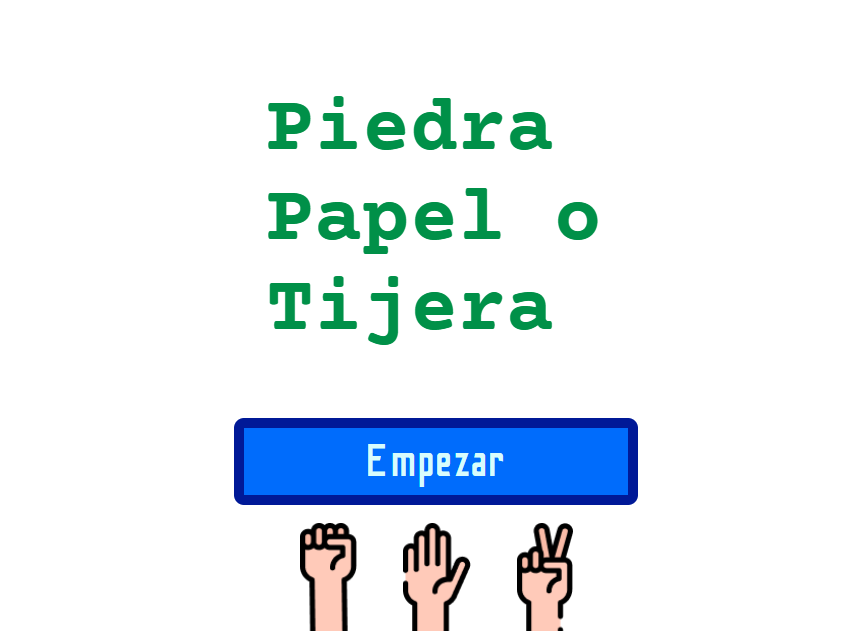

# Piedra, Papel o Tijera

Juego interactivo de Piedra, Papel o Tijera.

## Demo

**Jugar online:** [Jugar Piedra, Papel o Tijera](https://martinvisuara.github.io/juego-piedra-papel-o-tijera/)

## Captura del proyecto



## Funcionalidades

- Selección de piedra, papel o tijera.
- Jugada aleatoria de la computadora.
- Cuenta regresiva antes de mostrar las jugadas.
- Cálculo del resultado de cada partida.
- Marcador con victorias, derrotas y empates.
- Historial de partidas guardado en `localStorage`.
- Diseño adaptable a computadoras y dispositivos móviles.

## Tecnologías utilizadas

- HTML
- CSS
- TypeScript
- Vite
- Web Components y Shadow DOM
- LocalStorage
- Git y GitHub
- GitHub Pages para la publicación

## Ejecutar el proyecto localmente

Instalar las dependencias:

```bash
pnpm install
```

Iniciar el servidor de desarrollo:

```bash
pnpm dev
```

Compilar el proyecto:

```bash
pnpm build
```

## Publicación

El proyecto se publica en GitHub Pages mediante GitHub Actions. Al subir cambios a la rama `main`, se ejecuta automáticamente el proceso de compilación y publicación.
